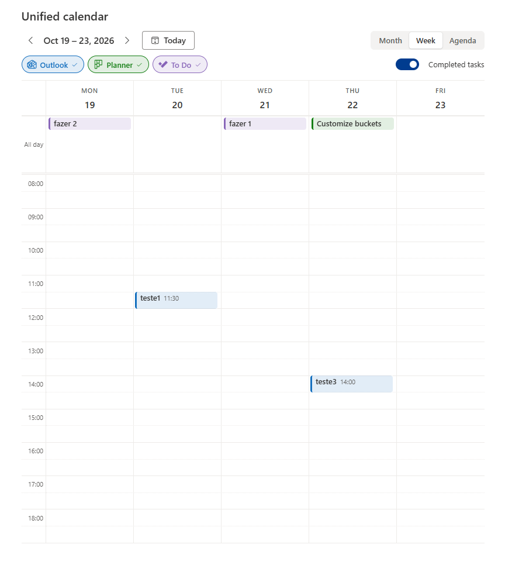
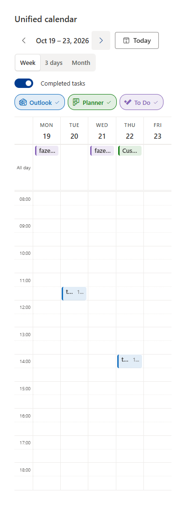
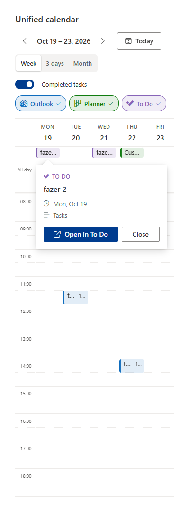
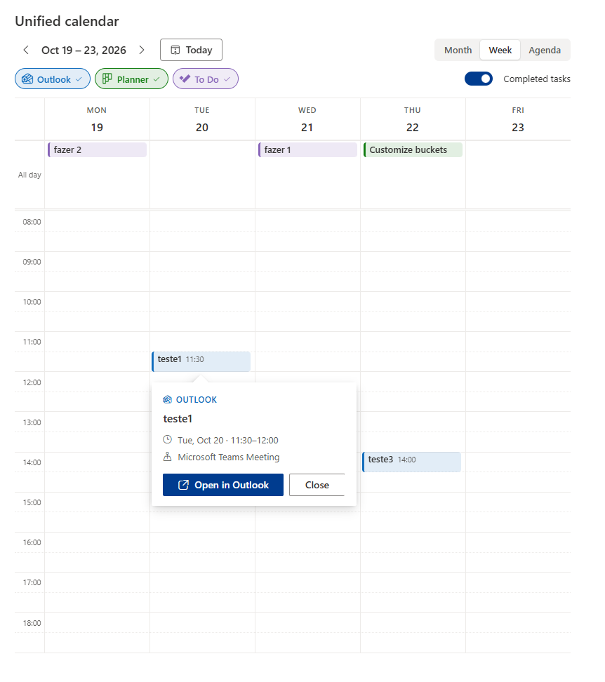
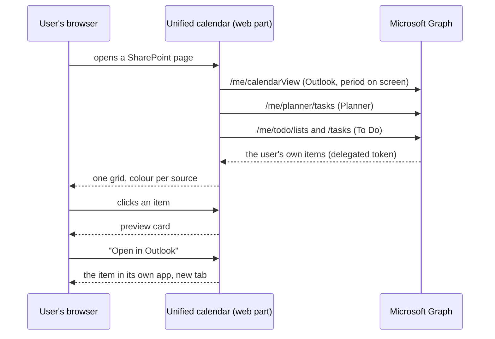
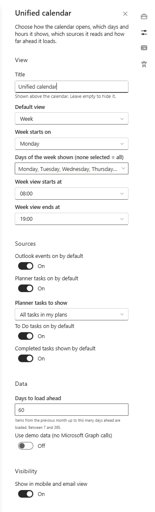

# Unified calendar for SharePoint Online

One personal calendar on the intranet. It shows, for the signed-in user and in a single grid:

- **Outlook** events
- **Planner** tasks with a due date
- **Microsoft To Do** tasks with a due date

Everything is read through Microsoft Graph with the user's own permissions. Nothing is stored, nothing is written back, and a click on any item opens it in the app it came from.



<p align="center">
  
  &nbsp;&nbsp;
  
</p>




> This repository distributes the **packaged solution** (`.sppkg`), the installation scripts and the documentation. The source code is not published.

## Contents

- [What it does](#what-it-does)
- [How it works](#how-it-works)
- [Requirements](#requirements)
- [Install](#install)
  - [Option A: tenant app catalog](#option-a-tenant-app-catalog)
  - [Option B: site collection app catalog](#option-b-site-collection-app-catalog)
  - [Approve the Microsoft Graph permissions](#approve-the-microsoft-graph-permissions)
  - [Add it to a page](#add-it-to-a-page)
- [Settings](#settings)
- [Privacy and security](#privacy-and-security)
- [Troubleshooting](#troubleshooting)
- [Uninstall](#uninstall)
- [Changelog](#changelog)
- [License](#license)

## What it does

- **Three sources, one grid.** Outlook events, Planner tasks and To Do tasks, each in its own colour, with the product icon on its chip. Switch any source off with one click; nothing is requested for a source that is off.
- **Month, week and agenda views.** In a narrow column or on a phone the views become week, three days and month, with bigger touch targets. The web part measures its own width, so it behaves the same in a one-third column on a monitor and on a phone.
- **Working-week settings.** Choose the days of the week to show (Monday to Friday by default) and the hours of the week view (08:00 to 19:00 by default). The clock is always 24-hour.
- **Completed tasks** are visible by default, dimmed, struck through and marked with a check. One toggle hides them.
- **Preview before you leave the page.** A click opens a small card with the source, the title, when, where (location, plan or list) and one button that opens the item in Outlook, Planner or To Do.
- **Follows the site.** Theme colours, dark mode and section backgrounds come from the SharePoint theme; fonts follow the site's Brand Center font package; texts are in the page language (English and Portuguese shipped, dates in any language).
- **Honest states.** A loading bar, an empty message with a hint, a yellow bar when one source cannot be read (no mailbox, no licence, permission not approved) while the others still render, and a red bar with "Try again" only when nothing could be read.
- **Accessible.** Labelled regions, keyboard navigation on every control, screen-reader hints on each item, focus returns to the item when the preview closes.

## How it works



- The web part runs entirely in the browser. There is no backend, no database and no telemetry.
- It calls Microsoft Graph with the **signed-in user's own token**, obtained by SharePoint through its standard client extensibility principal. A user can only ever see their own calendar and tasks.
- Items are loaded per source and per month, only for the period on screen, and kept in memory for five minutes. Going back and forth between weeks costs no new request.
- Each item carries the deep link of its app, so "Open in Outlook / Planner / To Do" always lands on the right thing.

## Requirements

- SharePoint Online with modern pages.
- Users need the licences of the sources they want to see: an Exchange Online mailbox for Outlook, Planner, Microsoft To Do. A user without one of them sees the others and a notice for the missing one. Frontline (F1) users, for instance, get Planner but no mailbox.
- To install: a **SharePoint Administrator** for the app catalog. To approve the Graph permissions: a **Global Administrator** (or a SharePoint Administrator who is allowed to grant consent in your tenant).
- Supported browsers: current Edge, Chrome, Firefox and Safari, on desktop and mobile. The SharePoint mobile app works too.

## Install

Everything you need is in this repository:

| File | Purpose |
|---|---|
| `package/spfx-unified-calendar.sppkg` | The solution package |
| `scripts/Install-UnifiedCalendar.ps1` | Optional: uploads, publishes and approves the permissions with PnP PowerShell |
| `scripts/Add-UnifiedCalendarToPage.ps1` | Optional: puts the web part on a page with the settings you choose |

The package is also attached to every [GitHub release](https://github.com/zemanel20/spfx-unified-calendar/releases); the latest one is always the file to install.

Pick **one** of the two app catalog options, then approve the permissions, then add the web part to a page.

### Option A: tenant app catalog

Makes the web part available on every site of the tenant.

1. Open the SharePoint admin center, **More features > Apps > App catalog** (or go straight to your app catalog site).
2. **Apps for SharePoint > Upload**, choose `spfx-unified-calendar.sppkg`.
3. In the dialog, tick **Make this solution available to all sites in the organization** and click **Deploy**. The dialog also lists the two Microsoft Graph permissions the package asks for; they are approved in the next step, not here.

With PnP PowerShell instead:

```powershell
.\scripts\Install-UnifiedCalendar.ps1 `
  -AppCatalogUrl https://contoso.sharepoint.com/sites/appcatalog `
  -ClientId <your PnP PowerShell app id>
```

### Option B: site collection app catalog

Keeps the web part inside one site collection, for a pilot or a single intranet site.

1. If the site has no app catalog yet, a SharePoint Administrator creates one:
   ```powershell
   Connect-PnPOnline -Url https://contoso-admin.sharepoint.com -ClientId <app id> -Interactive
   Add-PnPSiteCollectionAppCatalog -Site https://contoso.sharepoint.com/sites/intranet
   ```
2. On the site, **Site contents > Apps for SharePoint > Upload**, choose `spfx-unified-calendar.sppkg` and click **Deploy**.
3. **Site contents > New > App**, pick **spfx-unified-calendar** and add it to the site.

With PnP PowerShell instead:

```powershell
.\scripts\Install-UnifiedCalendar.ps1 `
  -AppCatalogUrl https://contoso.sharepoint.com/sites/intranet `
  -Scope Site `
  -ClientId <your PnP PowerShell app id>
```

### Approve the Microsoft Graph permissions

The package asks for two **delegated** permissions. Delegated means the web part can only read what the signed-in user can already read, and only while the user is on the page.

| Permission | Why |
|---|---|
| `Calendars.Read` | Outlook events of the signed-in user |
| `Tasks.Read` | Planner tasks and To Do lists of the signed-in user |

Whatever the app catalog you used, the requests land in the same place:

1. SharePoint admin center, **Advanced > API access**.
2. Under **Pending requests**, select each `spfx-unified-calendar` line and click **Approve**.

Until this is done, the web part shows the yellow bar "Some sources couldn't be read" for every source. The install script tries to approve them for you; if your account cannot, it prints the path above.

### Add it to a page

1. Edit a modern page, click **+** in a section and pick **Unified calendar** from **Text, media, and content**.
2. Open the property pane (pencil icon) and set the title, the default view, the days and hours, the sources and the Planner scope. See [Settings](#settings).
3. Republish the page.

A one-third column is a good home for it: the web part switches to its narrow layout on its own. Or let the script do it:

```powershell
.\scripts\Add-UnifiedCalendarToPage.ps1 `
  -SiteUrl https://contoso.sharepoint.com/sites/intranet `
  -PageName Home.aspx -Section 2 -Column 2 `
  -Title "My week" `
  -ClientId <your PnP PowerShell app id>
```

## Settings

| Setting | Default | What it does |
|---|---|---|
| Title | "Unified calendar" (in the page language) | Heading above the calendar; empty hides it |
| Default view | Week | Month, Week or Agenda when the page opens |
| Week starts on | Monday | Monday or Sunday |
| Days of the week shown | Monday to Friday | Which weekday columns exist, in every view; select none to show all seven |
| Week view starts at / ends at | 08:00 / 19:00 | Time axis of the week view. Items outside the window are still in the month and agenda views |
| Outlook / Planner / To Do on by default | On | Initial state of each source chip |
| Planner tasks to show | Assigned to me | "Assigned to me" or "All tasks in my plans" (every plan the user is a member of, including unassigned tasks) |
| Completed tasks shown by default | On | Initial state of the "Completed tasks" toggle |
| Days to load ahead | 60 | Size of the first load, 7 to 365 days; navigation loads more on demand |
| Use demo data | Off | Shows sample items instead of calling Microsoft Graph, for screenshots and demos |

The weekday names in the pane come from the page language.



## Privacy and security

- **Delegated permissions only.** No application permissions, no service account, no client secret anywhere.
- **Nothing leaves Microsoft 365.** The web part talks to `graph.microsoft.com` and nothing else; there is no third-party service and no telemetry.
- **Nothing is stored.** Items live in the browser's memory while the page is open and are discarded with it.
- **Read-only.** The package requests `.Read` scopes; it cannot create, change or delete anything.
- The two scopes are listed in the package manifest and shown by SharePoint at upload time, so an administrator can verify them before approving.

## Troubleshooting

| What you see | What it means | What to do |
|---|---|---|
| Yellow bar, "Some sources couldn't be read: Outlook, Planner, To Do" right after install | The Graph permissions are not approved yet | [Approve them](#approve-the-microsoft-graph-permissions), then reload |
| Yellow bar for one source only | The user has no licence or mailbox for that source | Nothing to fix; the others work. Switch the source off in the property pane for that audience if you prefer |
| Planner is empty although the user has tasks | By default only tasks **assigned** to the user are shown, and only those with a **due date** | Assign the tasks, give them due dates, or set "Planner tasks to show" to "All tasks in my plans" |
| To Do is empty | Only tasks with a due date have a place on a calendar | Add due dates in To Do |
| A change in Planner or To Do does not show up | Items are cached for five minutes | Wait, or click "Try again" in a bar, or reload the page |
| The week view hides an early or late meeting | It is outside the hours set for the week view | Widen "Week view starts at / ends at", or use the agenda view, which shows everything |
| The web part shows sample items | "Use demo data" is on | Switch it off in the property pane |

## Uninstall

- Remove the web part from the pages that use it.
- Tenant app catalog: open the catalog, select `spfx-unified-calendar`, **Remove**. Then in **API access**, revoke `Calendars.Read` and `Tasks.Read` if no other solution needs them.
- Site collection app catalog: **Site contents**, remove the app from the site, then delete it from the site's app catalog.

Nothing else is left behind: the solution creates no lists, no columns and no settings outside the page it sits on.

## Changelog

See [CHANGELOG.md](CHANGELOG.md).

## License

Released under the [MIT License](LICENSE). Made by José Fernandes.
